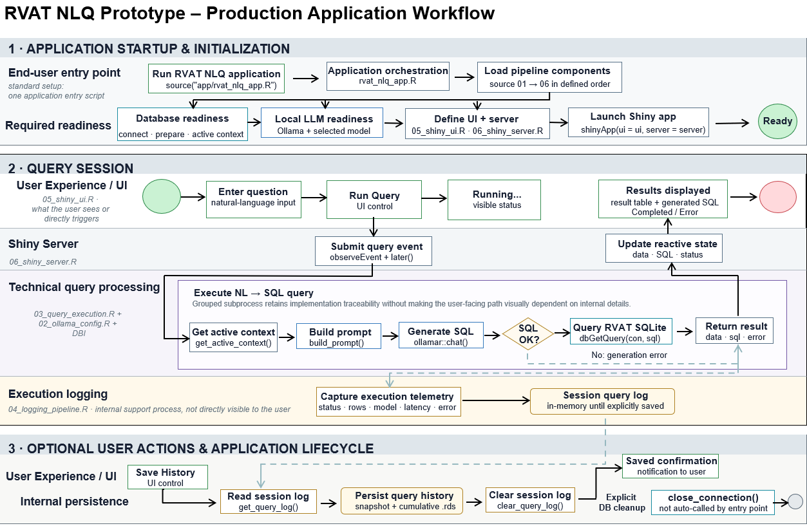

---
output:
  html_document: default
---
RVAT NLQ Interface
================
Version: 1.1 \
Date:    2026.11.22

A Natural Language Query (NLQ) interface prototype for exploring RVAT genetic
variant data using locally hosted Large Language Models (LLM's).

================

# Introduction

## RVAT Natural Language Query (NLQ) Interface

### Project Objective
This project evaluates whether Large Language Models (LLM's) can effectively 
translate natural language questions into executable SQL queries for scientific 
analysis and research of datasets against the RVAT database.

**RVAT** (Rare Variant Association Toolkit) was developed by 
[Kevin Kenna and Paul Hop](https://kennalab.github.io/rvat/articles/basics.html) 
and is an R package and command-line toolkit designed for large-scale genetic 
association testing using rare genomic variants.

The RVAT NLQ Interface allows users to interact with a database using natural 
language rather than writing SQL manually. 

A user's question is translated into SQL by an Ollama-hosted LLM, executed 
against the target database, and the results are returned through a Shiny-based 
web interface.

### Research Question

The primary objective is to assess:

To what extent can a locally hosted Large Language Model (LLM), integrated within an 
R environment, translate natural language queries into accurate SQL queries and 
use them to retrieve relevant data from an Amyotrophic Lateral Sclerosis (ALS) specific RVAT database, as evaluated 
using predefined benchmark questions?

The project establishes three core technical objectives:

•  be used as an evaluation framework for Natural Language → SQL generation; \
•  serve as a reference implementation of a local, privacy-preserving LLM-driven query interface; \
•  demonstrate reproducible R/Shiny application that can be deployed in research or server environments.

------------------------------------------------------------------------

# RVAT NLQ Architecture Overview

The RVAT NLQ Interface consists of a production application layer, a benchmark and 
evaluation workflow, and supporting analysis, validation and reporting components. 
Together these components enable reproducible evaluation of Large Language Models (LLM's) 
against RVAT benchmark questions.

For a detailed description of the repository structure, research workflow, validation strategy and reproducibility model, see:

**[RVAT NLQ Interface Prototype Architecture and Project Structure](docs/rvat-nlq-interface_project_structure.html)**

([RMarkdown source](docs/rvat-nlq-interface_project_structure.Rmd))

## Production Application Components

The production application consists of six core components located under the `/R/` folder:

| Script                  | Purpose                                |
| ----------------------- | -------------------------------------- |
| `01_db_connection.R`    | Database connection management         |
| `02_ollama_config.R`    | Ollama and LLM configuration           |
| `03_query_execution.R`  | Natural language → SQL execution logic |
| `04_logging_pipeline.R` | Query logging and metadata capture     |
| `05_shiny_ui.R`         | User interface                         |
| `06_shiny_server.R`     | Application server logic               |

These components are orchestrated through:

`/app/rvat_nlq_app.R`

This is the only script end users need to run. All other production components are loaded automatically.

## Production Application Workflow

{width=14in}

*Figure 01. Production workflow of the RVAT NLQ application prototype. During application initialisation, database, model and server components are loaded. Natural-language questions are translated into SQL, executed against the database and returned to the user while execution metadata are logged. Optional user actions support saving, loading and clearing query history. Black arrows represent control flow and blue dashed arrows represent data flow.*

------------------------------------------------------------------------

# System Requirements

## Hardware and Software Specifications

**Server Environment (Recommended)**

For full reproducibility:

• Linux Server (x86_64-pc-linux-gnu)                \
• 32 CPU cores                                      \
• 64 GB RAM (~49GB memory available)                \
• R version 4.5.0 (2025-04-11)                      \
• RStudio 2025.05.0 Build 496.pro5, Posit Software  \
• Git version 2.34.1                                \
• Ollama installed (version 0.21.0)                 \
👉 https://ollama.com/                              \
• One or more LLM's (default: qwen2.5-coder:latest)             

This configuration was used throughout development and validation.

------------------------------------------------------------------------

# Getting Started

Before starting, ensure you have met the (minimum) 'Hardware and Software Specifications' described above.
This Getting Started instructions are meant for **Server Environment (Recommended)**. 

For **Local Laptop Environment**, see below.   

### Create a Copy of this Project 

1.	Clone the Github repository
2.	Make a corresponding R project in Rstudio(Posit)
3.	Run renv::restore() in console

### Verify Package Dependencies (optional)

4. Run `/scripts/00_renv_setup.R` to verify the restored environment

### Configure LLM (optional) 
If using another LLM than default (= qwen2.5-coder:latest), configure chosen LLM as follows before running app:

5. Open `/R/02_ollama_config.R` and edit the following line of code accordingly: \
model_name <- "qwen2.5-coder:latest", under [MODEL CONFIGURATION (USER EDITABLE)])

### Database Usage Mode (optional)
By default, database mode is set to "synthetic" as defined in `R/01_db_connection.R`, which uses an augmented, subset of the database
based on the `varInfo` table. To use all the full RVAT geodatabase schema (e.g. varInfo, var, pheno, anno, meta, dosage, etc.),
switch to `full_gdb` before running the application by:

6. Open `/R/01_db_connection.R`, follow the instructions and edit under 
[DEFAULT MODE (CHANGE FOR PRODUCTION)] by commenting / un-commenting desired setting.    

### Run the Application

7. Run "/app/rvat_nlq_app.R"

For troubleshooting, see **Utilities and Troubleshooting** below.

================

**Local Laptop Environment**\
Local Windows laptop execution is supported although very experimental at this stage and much dependent on available hardware.\
Local Windows laptop execution is thus provided on a best-effort basis for reproducibility and demonstration purposes.\

 
Smaller models generally perform reasonably:

mistral:latest    \
qwen2.5-coder:latest    

Large models may experience reduced performance or even freeze:

qwen3:8b    \
sqlcoder:latest   

Depending on available CPU and RAM these models may:

- require several minutes to respond
- consume substantial resources
- produce unstable behaviour during long-running requests

This behaviour is related to hardware constraints rather than application logic.

**Laptop Reference Specifications:**\
Configuration A:                    \
• Dell Latitude 5220                \
• Windows 11 Pro (x64)              \
• CPU: 4 cores                      \
• 8 GB RAM                          \

Configuration B:                    \
• HP EliteBook 6 G1i                \
• Windows 11 Enterprise (x64)       \
• Intel Core Ultra 5 225U           \
• 12 CPU cores (14 logical processors)  \
• 16 GB RAM                             \

**Windows & Bioconductor Note** \
RStudio and R do not natively require Bioconductor on Windows. However, core genomic dependencies used in this project (such as `SummarizedExperiment`, required upstream by `rvat`) frequently fail to resolve automatically on Windows via standard `install.packages()`. 

While macOS and Linux typically handle these upstream Bioconductor dependencies dynamically, Windows environments require explicit initialization of `BiocManager` to register the necessary repositories and build binary packages smoothly.

**Windows & Rtools45 Note** \
Some project dependencies (including packages such as `Rcpp`, `stringi`, `curl`, and `XML`) may need to be compiled from source during `renv::restore()`. While Linux environments typically provide the required build tools by default, Windows requires `Rtools45` to supply essential compilation utilities (e.g. `make`, `gcc`, and `sh`).

Without a correctly installed and configured `Rtools45`, package restoration may fail with errors such as `'make' not found` or `'sh' is not recognized as an internal or external command`, preventing installation of core dependencies required by the application.

**Setup Script for Laptop Users** \
To streamline setup and resolve cross-platform dependency issues (especially on Windows), an automated setup script is included in the project root: `/scripts/00_renv_setup.R`.

This script automatically:        \
* Verifies and installs `renv` and `BiocManager` (ensuring correct Bioconductor repository mapping). \
* Restores the exact project dependencies via `renv::restore()`.                                     \
* Conducts post-installation checks to ensure core packages (`shiny`, `dplyr`, `DBI`, `RSQLite`, `rvat`, `ollamar`) are ready.

#### Getting Started on Windows Laptop

1. Ensure at least:                                     \
• Windows 11 Pro (x64)                                  \
• CPU: 4 cores                                          \
• 8GB RAM (available memory 7.5GB)                      \
• Disk space to download Ollama/LLM's locally           \
👉 Individual LLM's may require up to tens of GB's of disk space!

2. Install:                                           \
• R version 4.5.0 (2025-04-11)                        \
• RStudio 2025.05.0 Build 496.pro5, Posit Software    \
• Git version 2.34.1                                  \
• Rtools45 (required for Windows package compilation) \
👉  https://cran.r-project.org/bin/windows/Rtools/    \
• Ollama installed (version 0.21.0)                   \
👉 https://ollama.com/                                \
• One or more LLM's (default: qwen2.5-coder:latest) 

3. Create a Copy of this Project                    \
•	Clone the Github repository                       \
•	Make a corresponding R project in Rstudio(Posit)  \
                    
4. Restore project environment and verify Package Dependencies (including Bioconductor Windows dependency)

• Run `/scripts/00_renv_setup.R`

5. Configure LLM (optional) 
If using another LLM than default (= qwen2.5-coder:latest), configure chosen LLM as follows before running app:

• Open `/R/02_ollama_config.R` and edit the following line of code accordingly: \
model_name <- "qwen2.5-coder:latest", under [MODEL CONFIGURATION (USER EDITABLE)])

6. Database Usage Mode (optional, default is advisable for laptop usage)
By default, database mode is set to "synthetic" as defined in `R/01_db_connection.R`, which uses an augmented, subset of the database
based on the `varInfo` table. To use all the full RVAT geodatabase schema (e.g. varInfo, var, pheno, anno, meta, dosage, etc.),
switch to `full_gdb` before running the application by:

• Open `/R/01_db_connection.R`, follow the instructions and edit under 
[DEFAULT MODE (CHANGE FOR PRODUCTION)] by commenting / un-commenting desired setting.

7. Run the Application
• Run "/app/rvat_nlq_app.R"

For troubleshooting, see **Utilities and Troubleshooting** below.

---

## Utilities and Troubleshooting
The `/utils/` directory contains standalone validation and troubleshooting scripts for testing individual layers of the application. 
The scripts follow the application pipeline sequentially and are intended for development and troubleshooting, not production use.

| Script | Purpose | Use case |
|---|---|---|
| `100_check_db_connection.R` | Validates database connectivity, schema access, queries, and basic performance. | Run first to verify the database and active table are accessible and functioning correctly. |
| `110_check_full_gdb_relationships.R` | Validates Full-GDB table relationships and referential integrity. | Run after the database connection check when using `full_gdb` to verify that required cross-table relationships are available. |
| `200_check_ollama_config.R` | Validates Ollama connectivity, model availability, prompt construction, and SQL generation. | Use when configuring or troubleshooting the local LLM and NL → SQL generation. |
| `300_check_query_execution.R` | Validates the complete NL → SQL → database execution layer, including output structure and error handling. | Use to verify that natural-language queries can be converted to SQL and executed successfully. |
| `400_check_logging_pipeline.R` | Validates query logging, model metadata, execution timing, and log management. | Use to confirm that query execution is correctly captured by the logging pipeline. |
| `500_check_shiny_ui.R` | Performs static validation of the Shiny UI structure, required components, and supporting files. | Use after UI changes to check that required inputs, outputs, and resources are present. |
| `600_check_shiny_server.R` | Validates Shiny server logic and its integration with query execution, logging, and log saving. | Use to test back-end integration without launching the full Shiny application. |

## Model Selection and Triage

The triage scripts support developers who configure, evaluate or extend the application. These scripts are not required for normal end-user operation but provide a structured approach for assessing candidate LLM's before inclusion in the benchmark workflow.

| Script | Purpose |
|----------|----------|
| `20_select_model_guide.R` | Profiles locally available Ollama models and supports model-selection decisions. |
| `30_run_triage_llm.R` | Generates SQL and captures LLM performance metrics for comparative evaluation. |
| `31_run_triage_executor.R` | Executes reproducible triage benchmarks and evaluates model suitability. |

## Software Dependencies and Citations

This project builds upon several open-source tools and packages. If you use or extend this project, please consider citing the corresponding software according to the guidance provided by the maintainers.

| Software | Role in this project |
|-----------|---------------------|
| RVAT / rvatData | Genetic association analysis framework and reference datasets |
| Ollama | Local LLM hosting and inference platform |
| ollamar | R interface for Ollama |
| Shiny | Web application framework |
| QueryChat (in demo) | Early proof-of-concept experimentation |
| Ellmer (in demo) | Early QueryChat-based prototype experimentation |

Formal citation records are available in [`docs/citations.bib`](docs/citations.bib)

## Feedback

Feedback and user experiences are welcome through the repository's GitHub Discussions page.

👉 [Start a new discussion](https://github.com/ProjecticumDlerpDs/rvat_nlq_interface_dca/discussions/new/choose)

If you use the RVAT NLQ Interface, it would be particularly interesting to hear about:

- Research or analytical use cases;
- Query quality and usability;
- LLM's and configurations tested;
- Laptop performance and hardware specifications.

Community feedback helps identify improvement opportunities and supports future development of the project.

👉 Start a new discussion:
https://github.com/ProjecticumDlerpDs/rvat_nlq_interface_dca/discussions/new/choose
